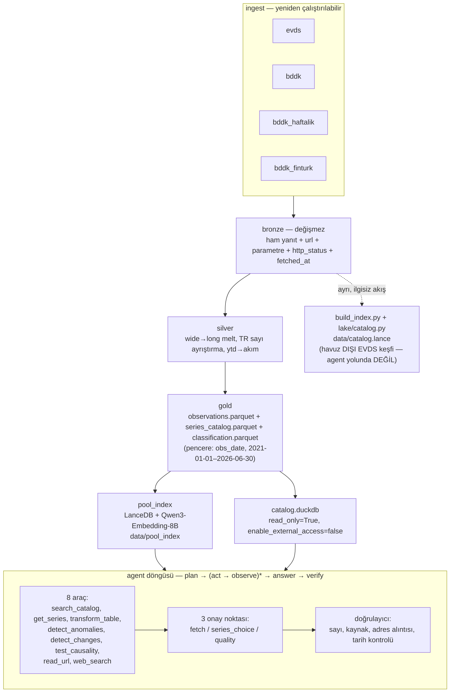

# Mimari

Bu doküman `README.md`'de özetlenen mimariyi katman katman açar. Şema
detayları için `docs/contracts.md`, dosya/alan detayları için
`docs/data_dictionary.md`, gerekçeler için `docs/decisions.md`'ye bakın —
burada onlar tekrar edilmiyor, yalnızca birbirine bağlanıyor.

## Genel akış

**İki ayrı LanceDB indeksi var, karıştırılmaz.** Agent'ın araması yalnızca
`data/pool_index` üzerinde çalışır (gold `series_catalog` üzerine kurulu,
`lake/pool_index.py`). `build_index.py` ve `data/catalog.lance` ham EVDS
bronze kataloğunu indeksler ve yalnızca havuz **dışı** keşif için durur —
agent döngüsünün hiçbir adımında kullanılmaz.

## ingest — bronze

`ingest/run.py`, `--source {evds,bddk,bddk_haftalik,bddk_finturk}` ile
çağrılır (EVDS için `--datagroups` ya da `--all` zorunlu). Her kaynağın
istemcisi (`ingest/evds.py`, `ingest/bddk_monthly.py`, ...) var olan dosyayı
kontrol eder ve atlar; ikinci koşuda sıfır HTTP çağrısı yapılır. EVDS anahtarı
HTTP header'ında (`key`) gönderilir, asla URL sorgu dizesinde; kaydedilen
her URL, loglanmadan önce anahtarı maskeler (`key=***`).

Bronze'a kaydedilen her kayıt: ham yanıt (dönüştürülmeden) + istek URL'i +
parametreler + HTTP durumu + çekim zamanı. EVDS'nin tek istekte en fazla 1000
gözlem döndürmesi ve aşımda en eski veriyi sessizce kesmesi nedeniyle çekim
veri grubu × yıl olarak parçalanır.

## silver

`lake/silver.py` (EVDS) ve `lake/bddk.py` bronze'un wide (her seri bir sütun)
biçimini long (satır bazlı gözlem) biçime çevirir (`melt`), BDDK'nin
`"1.234.567,89"` biçimli sayılarını ayrıştırır ve kâr-zarar kalemleri gibi
yıl başından kümülatif (`ytd`) seriler `analysis/transforms.decumulate_ytd`
ile aylık akıma çevrilir. Birim çevrilmez, yüksek frekanstan düşüğe gidilir,
eksik dönem doldurulmaz — bunlar `CLAUDE.md`'deki kesin kurallardır.

## gold

`lake/gold.py::build_gold()` silver'ı tek bir pencereye (`obs_date` üzerinden
2021-01-01 – 2026-06-30) indirger ve iki sözleşmeli dosyayı üretir:
`data/gold/observations.parquet` (`series_id, period, freq, value, unit,
source, fetched_at, obs_date`) ve `data/gold/series_catalog.parquet`
(`series_id, name_tr, name_en, source, freq, unit, kind, agg_method,
cum_type, start_date, end_date, topic, tags, metadata_url, notes`). Sınıflandırma
kararları (`kind`, `unit`, `agg_method`) `data/gold/classification.parquet`'e
ve okunabilir `docs/kind_review.md`'ye yazılır. Aynı adımda
`data/gold/catalog.duckdb` doldurulur; agent'a açılan bağlantı
`read_only=True` **ve** `enable_external_access=false` ile kurulur — SELECT'in
kendisi güvenli olsa da DuckDB `read_csv(...)`, `ATTACH`, `INSTALL/LOAD
httpfs` gibi yollarla yerel dosya okuma ve veri sızdırmaya izin verebildiği
için asıl kontrol motor seviyesindeki bu kısıt ve zorunlu `LIMIT`'tir, bir
anahtar kelime kara listesi değil. `run_sql` bu bağlantı üzerinde çalışacak
şekilde yazılmış ve test edilmiştir, ama henüz canlı sekiz araç kaydına
bağlanmamıştır (`docs/contracts.md` §7).

## pool_index — agent'ın arama yüzeyi

`lake/pool_index.py`, gold `series_catalog`'unun tamamını (45.422 seri)
Qwen3-Embedding-8B ile gömüp `data/pool_index` altında bir LanceDB indeksi
kurar. Agent'ın `search_catalog` aracı yalnızca bunu sorgular. Bunun
`build_index.py` + `data/catalog.lance` ile karıştırılmaması gerekir: o
ayrı komut ham EVDS bronze kataloğunu (havuza hiç girmemiş serileri de
içeren daha geniş bir küme) indeksler ve yalnızca "havuzda yoksa nerede
olabilir" tarzı keşif için elle çalıştırılır — agent döngüsünün parçası
değildir.

## agent döngüsü

`agent/loop.py`, üç modla çalışır: `--fake` (sahte model + sahte araç + sahte
lake, tam çevrimdışı smoke test), `--live` (gerçek MIA modeli + gerçek araçlar
ama sentetik veri — modelin kendisini veri havuzundan izole test eder),
`--real` (gerçek model + gerçek araç + gerçek gold veri — demoda koşan mod).

Her tur şu döngüyü izler: **plan** (ilk model çağrısı, hangi aracın
çağrılacağına karar verir) → **(act → observe)\*** (aracı çalıştır, sonucu
modele özetle, tekrar karar ver — bu döngü `max_steps=12` veya
`total_budget_s=180s` sınırına kadar sürer) → **answer** (araçsız, son
cevabı yazar) → **verify** (kural tabanlı, model çağrısı yapmaz).

### Sekiz araç

`search_catalog`, `get_series`, `transform_table` havuzdaki veriyle çalışır
(`lake_adapter.py` üzerinden gold + pool_index'e bağlanır); `detect_anomalies`,
`detect_changes`, `test_causality` saf `analysis/` fonksiyonlarını (STL+MAD,
PELT, Granger) sarar; `read_url` ve `web_search` havuz dışına çıkar ve
onay kapısından geçer. Her araç modele yalnızca bir `ToolResult` özeti
döner, ham tablo oturumda kalır (`docs/contracts.md` §4).

### Onay noktaları

Üç nokta, karar her zaman döngü tarafından verilir (araçlar kendi başına
onay istemez):

1. **`fetch`** — `read_url`/`web_search` çalışmadan önce.
2. **`series_choice`** — katalog aramasında en iyi iki adayın skoru
   birbirine çok yakınsa (oran eşiği %90) ve hiçbiri tam kod eşleşmesi
   değilse.
3. **`quality`** — yeni bir tabloda eksik oran %10'u aşıyorsa, tekrarlı
   dönem varsa veya birim bilinmiyorsa; seçenekler `continue` /
   `change_assumption` / `cancel`.

Onay bekleme süresi turun zaman bütçesinden düşülmez.

### Doğrulayıcı

`agent/verifier.py`, cevap yazıldıktan sonra dört kuralla kontrol eder
(model çağrısı olmadan, salt kural tabanlı):

1. Cevaptaki her sayı/aralık oturum tablolarında veya araç/kullanıcı
   metninde karşılığı var mı.
2. Cevapta anılan her seri kodu/URL oturumun kaynak listesinde mi.
3. Bu turda `read_url`/`web_search` başarıyla kullanıldıysa, cevap en az
   bir çekilen adresi anıyor mu.
4. Cevapta geçen her ay, oturum tablolarının kapsadığı aralıkta mı.

Bulgular sessizce düzeltilmez; cevabın altına görünür bir uyarı olarak
eklenir. Doğrulayıcı çökerse bu "bulgu yok" olarak okunur — turun cevabını
asla iptal etmez.

### Kaynak gösterimi

İki ayrı mekanizma, bilinçli olarak birbirine karıştırılmaz: cevap metni
içinde model kendi kaynağını (adresi kısaltmadan) alıntılar; tur bitiminde
oturumun **bütün** kaynakları tam adresleriyle ayrıca özetlenir. Bu özet
cevap metnine eklenmez — eklenirse doğrulayıcı, harness'ın bastığı adresi
modelin kendi alıntısı sanabilir.

## İlgili dokümanlar

- [docs/data_dictionary.md](data_dictionary.md) — bronze/silver/gold dosya
  tanımları, havuz ölçümü, EVDS ve BDDK kaynak detayları
- [docs/contracts.md](contracts.md) — şemalar, `ToolResult`, oturum durumu,
  olay listesi, onay noktalarının tam tanımı
- [docs/decisions.md](decisions.md) — her kararın gerekçesi ve ölçümü
  (ör. TÜFE zincirleme yapılmaması, LangGraph yerine kendi döngümüz)
